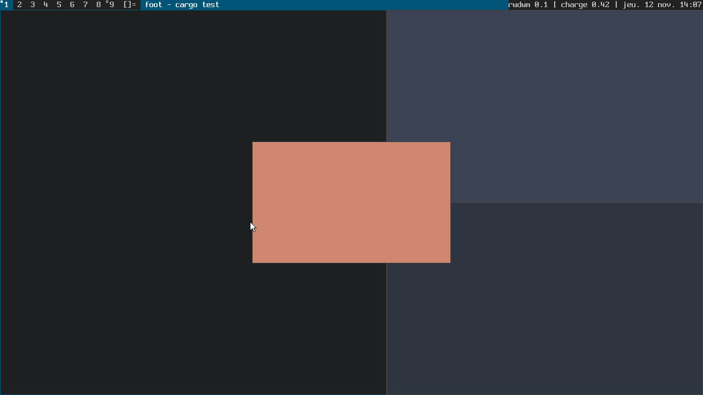

# rusted-wayland-dwm

**rwdwm** est un clone de [dwm](https://dwm.suckless.org/) pour **Wayland**, écrit en **Rust** avec [Smithay](https://github.com/Smithay/smithay) : tags, pavage maître/pile, monocle, flottant, barre intégrée, configuration compilée — sans serveur X.



*Capture produite sans écran ni GPU par le backend de test (`cargo run --example capture`) ; les fenêtres sont des clients Wayland de démonstration, de couleur unie.*

> **État : v0.1, non éprouvée sur du matériel.** La logique, les protocoles et le rendu sont couverts par 137 tests automatisés, exécutés par un compositeur réel en mode *headless*. Les backends matériels (`udev`, `winit`) **compilent mais n'ont encore jamais été ni liés ni exécutés** : voir [État d'avancement](#état-davancement).

## Ce que fait rwdwm

- **Tags** 1 à 9 par moniteur : `view`, `toggleview`, `tag`, `toggletag`, tagset précédent.
- **Dispositions** : tuile `[]=`, flottante `><>`, monocle `[M]` ; `mfact`, `nmaster`, `zoom`.
- **Barre intégrée** façon dwm (tags, symbole, titre, statut), cliquable, police bitmap embarquée ; statut lu sur l'entrée standard (`slstatus -s | rwdwm`).
- **Focus** qui suit la souris, bordures colorées, urgence, plein écran, règles par `app_id`/titre.
- **Multi-moniteurs** : tags et dispositions par moniteur, `focusmon`, `tagmon`, branchement à chaud.
- **Protocoles** : `xdg-shell`, `wlr-layer-shell` (lanceurs, barres, fonds d'écran), `xdg-decoration` (toujours côté serveur), `xdg-activation`, presse-papiers et sélection primaire, `wlr-data-control`, `linux-dmabuf`, `viewporter`, `cursor-shape`, `xdg-output`.
- **Raccourcis de dwm**, les touches de tags étant liées à leur position physique : elles fonctionnent sur AZERTY comme sur QWERTY.

Hors périmètre de la v0.1 : XWayland, verrouillage de session, capture d'écran, échelle fractionnaire, configuration à l'exécution. Voir la [feuille de route](docs/05-planification.md).

## Compiler

Rust 1.88 ou plus récent. Bibliothèques système (noms Debian/Ubuntu, donnés à titre indicatif : cette liste n'a pas pu être vérifiée dans l'environnement de réalisation) :

```sh
sudo apt install pkg-config libxkbcommon-dev libpixman-1-dev \
    libudev-dev libinput-dev libseat-dev libgbm-dev libegl1-mesa-dev libwayland-dev
cargo build --release          # target/release/rwdwm
```

Backends, sélectionnables par *features* Cargo (toutes actives par défaut) :

| Feature | Backend | Dépendances système |
|---------|---------|---------------------|
| `udev` | natif : DRM/KMS, libinput, libseat | libudev, libinput, libseat, libgbm, EGL/GLES |
| `winit` | fenêtre dans une session Wayland ou X11 | EGL/GLES |
| `headless` | sortie virtuelle, rendu logiciel (tests, captures) | libpixman |

## Utiliser

```sh
rwdwm                           # depuis un terminal virtuel (ou dans une fenêtre si une session graphique tourne)
rwdwm -s foot                   # lance une commande au démarrage
slstatus -s | rwdwm             # texte de statut sur l'entrée standard
rwdwm --backend winit           # force le mode fenêtre
rwdwm --help
```

Par défaut le terminal est [`foot`](https://codeberg.org/dnkl/foot) et le lanceur [`wmenu-run`](https://codeberg.org/adnano/wmenu).

| Raccourci (`Mod` = Alt) | Action |
|-------------------------|--------|
| `Mod+Maj+Entrée` / `Mod+p` | terminal / lanceur |
| `Mod+j` / `Mod+k` | client suivant / précédent |
| `Mod+h` / `Mod+l` | réduire / agrandir la zone maître |
| `Mod+i` / `Mod+d` | plus / moins de clients maîtres |
| `Mod+Entrée` | promouvoir en maître |
| `Mod+t` / `Mod+f` / `Mod+m` / `Mod+Espace` | tuile / flottant / monocle / disposition précédente |
| `Mod+Maj+Espace` / `Mod+e` | basculer flottant / plein écran |
| `Mod+[1-9]`, `Mod+0`, `Mod+Tab` | voir un tag / tous / les précédents |
| `Mod+Maj+[1-9]`, `Mod+Ctrl+[1-9]`, `Mod+Ctrl+Maj+[1-9]` | étiqueter / ajouter à la vue / ajouter un tag |
| `Mod+,` / `Mod+.` (+`Maj`) | moniteur précédent / suivant (y envoyer le client) |
| `Mod+b` | afficher ou masquer la barre |
| `Mod+Maj+c` / `Mod+Maj+q` | fermer le client / quitter |
| `Mod`+clic gauche / milieu / droit | déplacer / basculer flottant / redimensionner |
| `Ctrl+Alt+F1…F12` | changer de terminal virtuel |

## Configurer

Comme dwm : modifier [`crates/rwdwm/src/config.rs`](crates/rwdwm/src/config.rs) (l'équivalent de `config.h`), puis recompiler. Couleurs, tags, règles, dispositions, touches, boutons, clavier (disposition XKB), pavé tactile et échelle par écran y sont des données typées : une erreur de configuration est une erreur de compilation.

## Tester

```sh
cargo test -p rwdwm-core                                        # noyau : aucune dépendance système
cargo test -p rwdwm --no-default-features --features headless   # compositeur réel + clients Wayland (libxkbcommon, libpixman)
cargo check --workspace --all-features                          # tous les backends
```

Les tests d'intégration démarrent un vrai compositeur (backend headless, rendu logiciel) dans le processus de test, y connectent de vrais clients Wayland, injectent touches et clics, puis vérifient le modèle, les événements reçus par les clients et les pixels de l'image produite.

## Architecture

```
crates/rwdwm-core   noyau pur, sans dépendance : modèle dwm (moniteurs, clients, tags, focus),
                    dispositions, règles, barre (dessin compris), police embarquée
crates/rwdwm        compositeur Smithay : protocoles, entrées, rendu, backends udev / winit / headless
```

Le noyau est la seule source de vérité ; le compositeur traduit les événements en appels au noyau, puis applique le modèle obtenu. Aucun bloc `unsafe` dans les deux crates.

Documentation de conception :

1. [Spécifications fonctionnelles](docs/01-specifications-fonctionnelles.md)
2. [Recherche documentaire](docs/02-recherche-documentaire.md)
3. [Contraintes techniques](docs/03-contraintes-techniques.md)
4. [Architecture et spécifications techniques](docs/04-architecture-specifications-techniques.md)
5. [Planification](docs/05-planification.md)

## État d'avancement

| Lot | Contenu | État |
|-----|---------|------|
| L0 | Socle, documentation | fait |
| L1 | Noyau : modèle, dispositions | fait — testé (86 tests unitaires avec L2) |
| L2 | Noyau : barre, police | fait — testé |
| L3 | Compositeur : socle, `xdg-shell` | fait — testé en headless |
| L4 | Entrées : raccourcis, souris, statut | fait — testé en headless |
| L5 | Rendu : bordures, barre, curseur | fait — testé en headless (assertions sur les pixels) |
| L6 | Protocoles complémentaires | fait — `layer-shell`, activation et popups testés ; presse-papiers, `dmabuf`, `cursor-shape` : globals annoncés, échanges non testés |
| L7 | Backend `headless` | fait — testé, branchement à chaud compris |
| L7 | Backend `winit` | écrit — **vérifié par le compilateur seulement, jamais exécuté** |
| L7 | Backend `udev` | écrit — **vérifié par le compilateur seulement, jamais exécuté** |

Ce que cela signifie concrètement :

- **Vérifié par exécution** : 86 tests du noyau, 11 tests unitaires du compositeur, 37 tests d'intégration et 3 tests du binaire (137 au total), `clippy` et `rustfmt` sans remarque.
- **Vérifié par le compilateur uniquement** : `backend/winit.rs` et `backend/udev.rs` passent `cargo check` et `cargo clippy --all-features`, mais l'environnement de réalisation n'avait ni GPU, ni écran, ni siège, ni les bibliothèques système correspondantes. L'édition de liens d'un binaire complet et la première exécution sur une vraie machine **restent à faire** ; il faut s'attendre à des corrections. La marche à suivre est décrite dans la [recette manuelle](docs/05-planification.md#4-recette-manuelle-des-backends-matériels).
- **Limites connues du backend natif** : GPU principal seulement, mode vidéo préféré de chaque écran, pas de *direct scan-out* ni de plan curseur matériel, pas de mise à jour des voyants du clavier.

## Remerciements et licences

- rwdwm est distribué sous licence [MIT](LICENSE).
- Le comportement reproduit celui de [dwm](https://dwm.suckless.org/) (suckless.org, licence MIT/X) ; plusieurs choix propres à Wayland s'inspirent de [dwl](https://codeberg.org/dwl/dwl).
- La police de la barre est [Spleen](https://github.com/fcambus/spleen) 8×16 de Frédéric Cambus, licence BSD-2-Clause ([texte](crates/rwdwm-core/assets/LICENSE-spleen.txt)).
