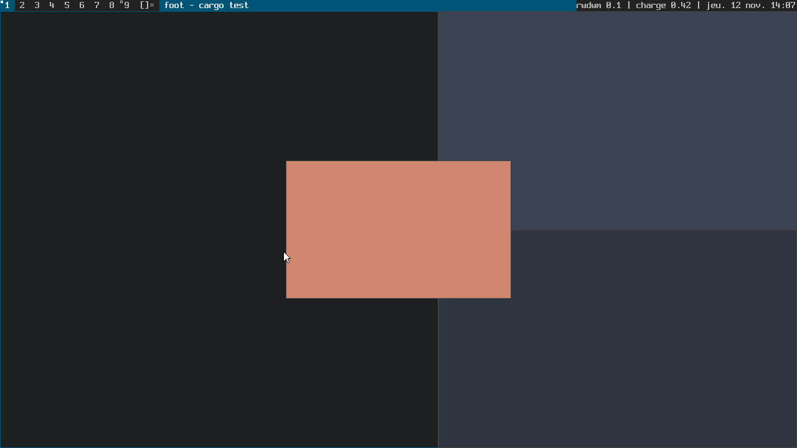

# Phase 5 — Planification des développements

## 1. Découpage en lots

Chaque lot est livrable et vérifiable indépendamment. Les lots L0 à L7 constituent la **v0.1**.

| Lot | Contenu | Dépend de | Critère d'acceptation |
|-----|---------|-----------|-----------------------|
| **L0 — Socle** | Espace de travail Cargo, deux crates, licences, README, documentation des phases 1 à 5. | — | `cargo check` passe. |
| **L1 — Noyau : modèle et dispositions** | `geometry`, `config` (types), `action`, `layout` (tile, monocle), `model` (moniteurs, clients, tags, focus, règles, plein écran, souris). | L0 | Tests unitaires verts ; invariants vérifiés après chaque opération. |
| **L2 — Noyau : barre** | Police Spleen embarquée, `BarView`, segments, dessin, test de clic. | L1 | Tests unitaires verts (métriques dwm, couleurs, troncature). |
| **L3 — Compositeur : socle Smithay** | `State`, socket, handlers `compositor`/`shm`/`seat`/`output`/sélections, `xdg_shell` (cycle de vie, popups), `sync()`. | L1 | Un client `xdg_toplevel` reçoit une configuration à la taille tuilée. |
| **L4 — Entrées** | Raccourcis (keysym + keycode), focus suit la souris, clics sur la barre, déplacement/redimensionnement, `spawn`, statut sur stdin. | L3 | Tests d'intégration : touches injectées → changement d'état ; relâchement non transmis. |
| **L5 — Rendu** | Éléments de rendu ordonnés, bordures, barre, curseur, suivi des dégâts, rappels de trame. | L2, L3 | Capture headless : barre et bordures aux bonnes couleurs et positions. |
| **L6 — Protocoles complémentaires** | `layer-shell` (zones exclusives, focus exclusif), `xdg-decoration`, `xdg-activation` (urgence), `cursor-shape`, `viewporter`, `dmabuf`, `data-control`, `single-pixel-buffer`. | L3 | Tests d'intégration layer-shell ; compilation. |
| **L7 — Backends** | `headless` (Pixman, canal de commandes), `winit`, `udev` (libseat, DRM/GBM/EGL, libinput, branchement à chaud, changement de VT). | L3–L5 | `cargo check --all-features` ; tests headless verts ; recette manuelle (§4). |

### Feuille de route après la v0.1

| Version | Lots |
|---------|------|
| **v0.2 — Usage quotidien** | L8 XWayland · L9 verrouillage de session (`ext-session-lock`) et inactivité (`idle-notify`, `idle-inhibit`) · L10 capture d'écran (`wlr-screencopy`) · L11 `wlr-output-management`, échelle fractionnaire, rotation |
| **v0.3 — Confort** | L12 rendu piloté par les événements, scanout direct et plan curseur (`FrameFlags::DEFAULT`), GPU secondaires, choix du mode vidéo · L13 contraintes de pointeur, pointeur relatif, gestes · L14 méthodes de saisie (`text-input`, `input-method`) · L15 transactions de redimensionnement (« chaque image est parfaite ») |
| **v0.4 — Ouverture** | L16 IPC (`rwdwm msg …`) et publication d'état pour barres externes · L17 configuration à l'exécution optionnelle · L18 dispositions additionnelles · L19 polices vectorielles |

## 2. Ordonnancement

```
L0 ─► L1 ─┬─► L2 ──────────┐
          └─► L3 ─┬─► L4 ──┤
                  ├─► L5 ◄─┘
                  ├─► L6
                  └─► L7 (headless d'abord : il conditionne les tests de L3 à L6)
```

Le backend **headless est développé en premier** dans L7 : il sert de banc d'essai à tous les autres lots. `winit` puis `udev` viennent ensuite, car ils ne font qu'habiller le même code générique.

## 3. Stratégie de vérification par lot

| Lot | Tests automatisés | Vérification complémentaire |
|-----|-------------------|-----------------------------|
| L1 | `crates/rwdwm-core/src/{geometry,layout,config,action}.rs`, `src/model/tests.rs` (tests unitaires) | — |
| L2 | `crates/rwdwm-core/src/{bar,font}.rs` | Inspection visuelle d'une capture |
| L3, L4, L6 | `crates/rwdwm/tests/integration.rs` ; `crates/rwdwm/src/config.rs` (cohérence de la configuration) | — |
| L5 | `crates/rwdwm/tests/integration.rs` (assertions sur pixels) | Capture `docs/capture-headless.png` |
| L7 | headless : exercé par tous les tests, branchement à chaud compris ; `crates/rwdwm/tests/cli.rs` (binaire) | `udev`/`winit` : compilation, puis recette manuelle |

Commandes :

```sh
cargo test -p rwdwm-core                                   # noyau
cargo test -p rwdwm --no-default-features --features headless   # intégration (libxkbcommon + libpixman)
cargo check --workspace --all-features                     # tous les backends (vérification de types)
cargo clippy --workspace --all-features --all-targets      # aucun avertissement
cargo fmt --all --check

# Capture d'écran sans écran ni GPU (docs/capture-headless.png) :
cargo run -p rwdwm --no-default-features --features headless --example capture -- docs/capture-headless.png
python3 tools/optimize_png.py docs/capture-headless.png
```



## 4. Recette manuelle des backends matériels

À dérouler sur une machine réelle (non exécutable dans l'environnement de réalisation).

**Imbriqué (`winit`)** — depuis une session Wayland ou X11 :

1. `cargo run --release -- --backend winit -s foot` : une fenêtre s'ouvre, la barre s'affiche, `foot` occupe la zone utile.
2. `MODKEY+Maj+Entrée` ×2 : trois terminaux, un maître à gauche, deux empilés à droite.
3. `MODKEY+j/k`, `MODKEY+h/l`, `MODKEY+i/d`, `MODKEY+Entrée`, `MODKEY+t/f/m` : comportements conformes au document 01.
4. `MODKEY+2`, `MODKEY+Maj+2`, `MODKEY+Tab`, clics sur les tags.
5. `MODKEY+p` : `wmenu-run` s'affiche par-dessus la barre et prend le clavier.
6. Redimensionner la fenêtre hôte : la disposition suit.
7. `MODKEY+Maj+q` : arrêt propre.

**Natif (`udev`)** — depuis un TTY, utilisateur membre d'un siège (seatd ou logind) :

0. Construire avec les bibliothèques système installées (`cargo build --release`) : c'est la **première édition de liens** des backends matériels, jamais faite pendant la réalisation.
1. `rwdwm -s foot` : affichage sur toutes les sorties connectées.
2. Mêmes vérifications que ci-dessus, plus : curseur visible, pavé tactile, `Ctrl+Alt+F2` puis retour, branchement/débranchement d'un écran, `MODKEY+,`/`.`.
3. `slstatus -s | rwdwm` : le statut s'affiche à droite de la barre.

## 5. Risques et parades

| Risque | Probabilité | Impact | Parade |
|--------|-------------|--------|--------|
| Backends `udev`/`winit` non exécutés pendant la réalisation | certaine | moyen | Code calqué sur les exemples de référence de Smithay (`anvil`, `smallvil`) ; backends minces ; recette §4 en priorité. |
| Évolutions d'API de Smithay (pré-1.0) | moyenne | moyen | Version figée (`0.7`, `Cargo.lock`) ; surface d'API concentrée dans `handlers/`, `render.rs`, `backend/`. |
| Clients ne respectant pas la taille configurée | moyenne | faible | Bordures tracées sur la géométrie allouée ; surfaces rognées à leur zone. |
| Absence de XWayland en v0.1 | certaine | moyen | Documentée ; lot L8 prioritaire en v0.2. |
| Couverture de glyphes limitée de la barre | faible | faible | Remplacement par `?` ; lot L19. |

## 6. État d'avancement

Voir le tableau de suivi dans le [README](../README.md#état-davancement), mis à jour à chaque livraison.
